# Algorithm2026

<b>HOMEWORK 1 - Sorting Algorithms</b>

 

### Selection Sort
[SelectionSorting.pde](homework/SelectionSorting.pde)  
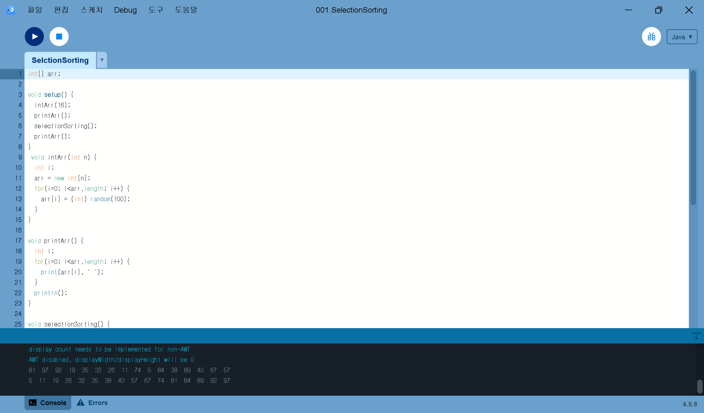

### Bubble Sort
[BubbleSorting.pde](homework/BubbleSorting.pde)  
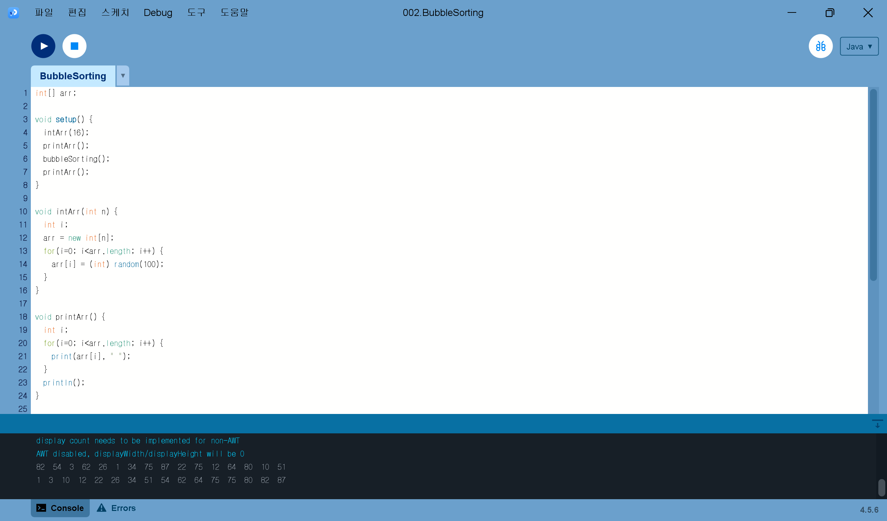

### Insertion Sort
[InsertionSorting.pde](homework/InsertionSorting.pde)  
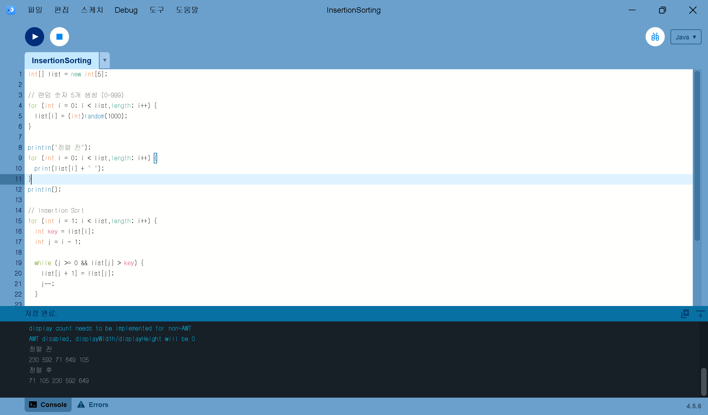

### Merge Sort
[MergeSorting.pde](homework/MergeSorting.pde)  
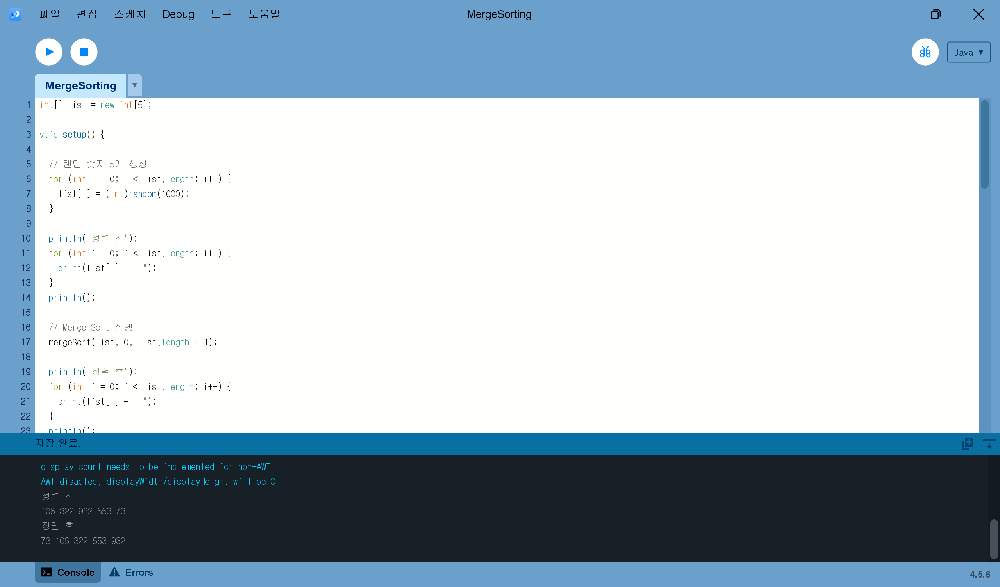

### Quick Sort
[QuickSorting.pde](homework/QuickSorting.pde)  
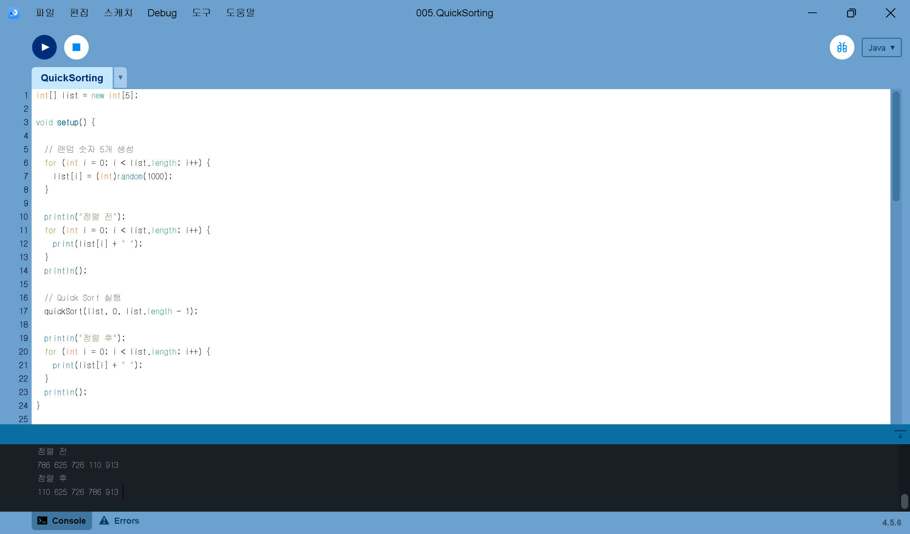

### Heap Sort
[HeapSorting.pde](homework/HeapSorting.pde)  
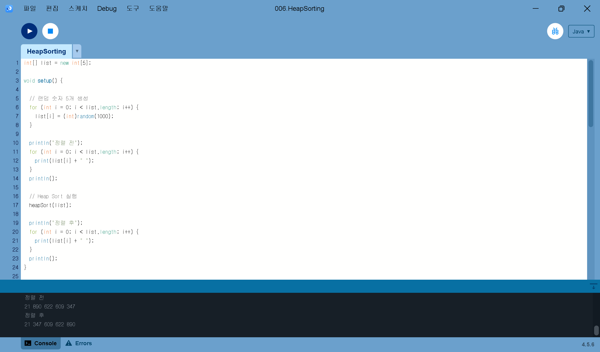

<b>HOMEWORK 2 - Sorting Animation</b>

 

### Sorting Animation

[SortingAnimation.pde](homework/SortingAnimation/SortingAnimation.pde)  
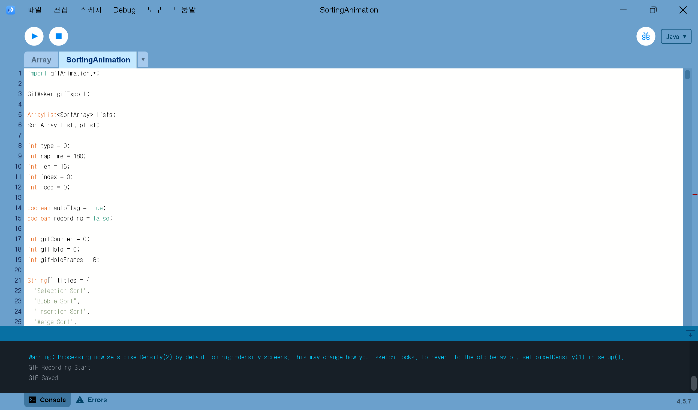

### Array

[Array.pde](homework/SortingAnimation/Array.pde)  
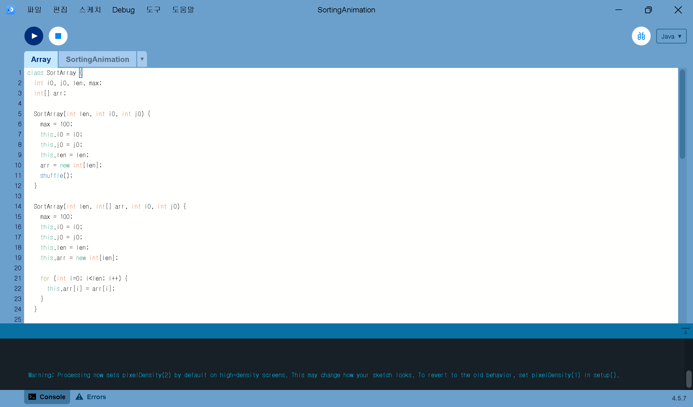

### Sorting Animation GIF

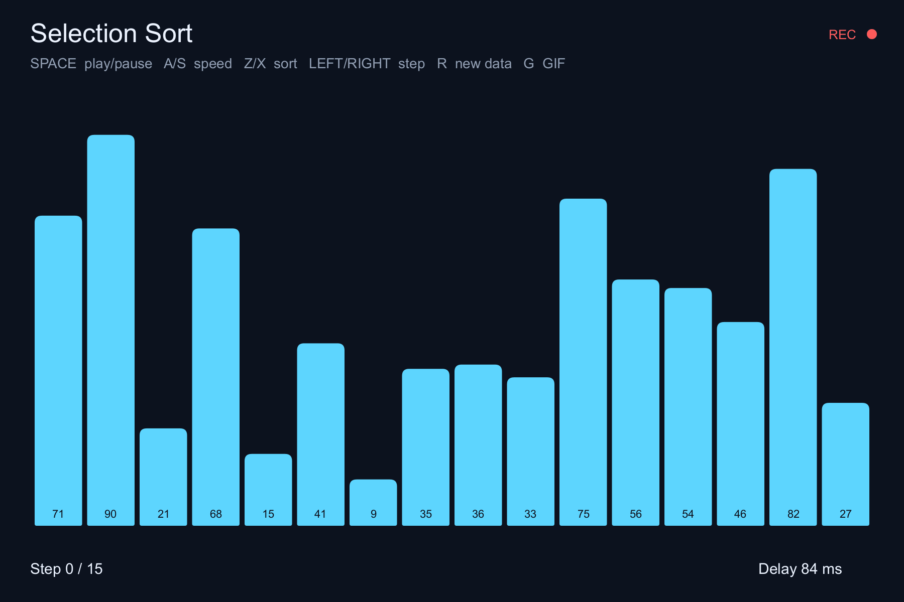

<b>HOMEWORK 3 - Pebble Placement Problem</b>

 

### Pebble Placement Problem

[PebblePlacementProblem.pde](homework/PebblePlacementProblem.pde)  
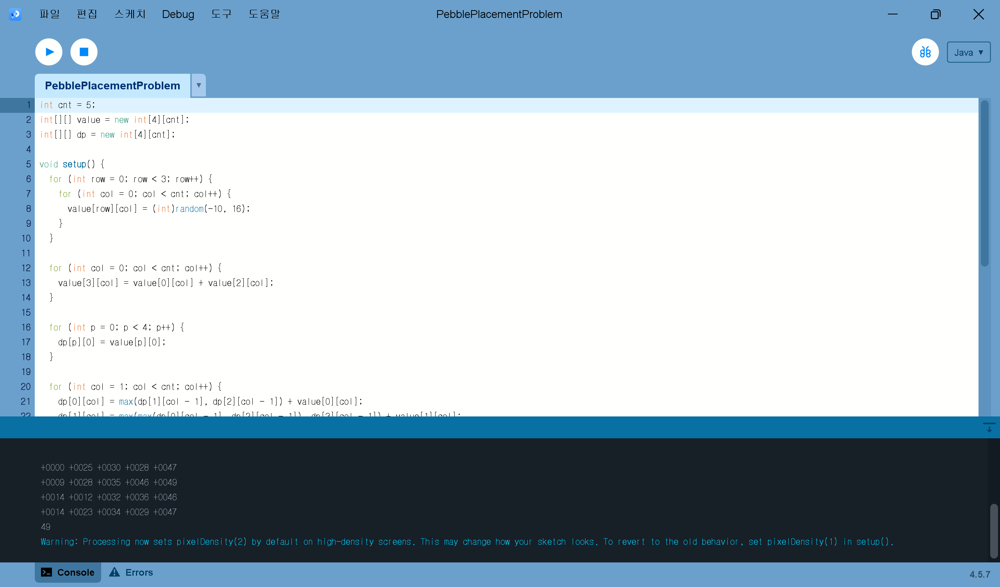

<b>HOMEWORK 4 - GraphSearch</b>

 

### Pebble Placement Problem

[GraphSearch.pde](homework/GraphSearch.pde)  
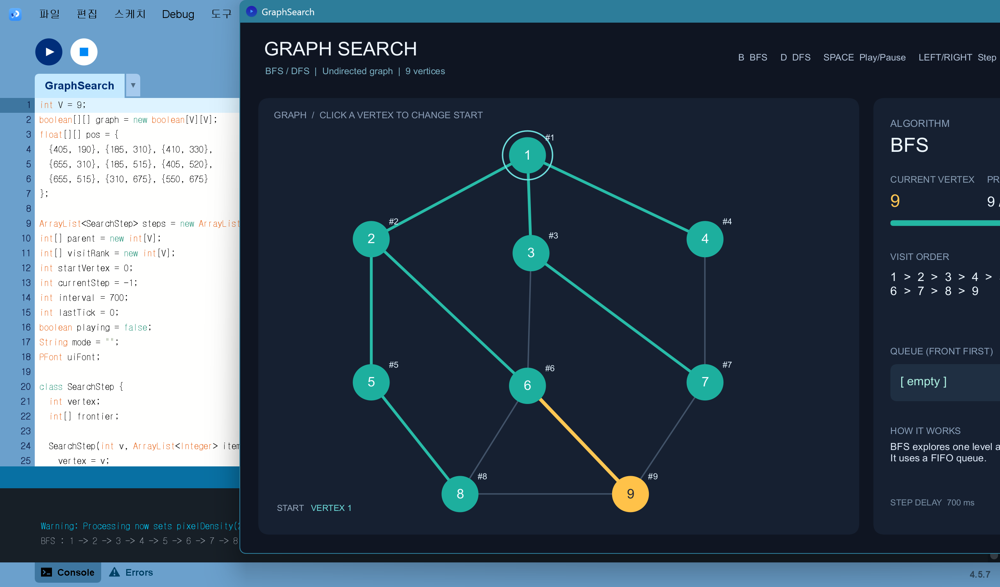

